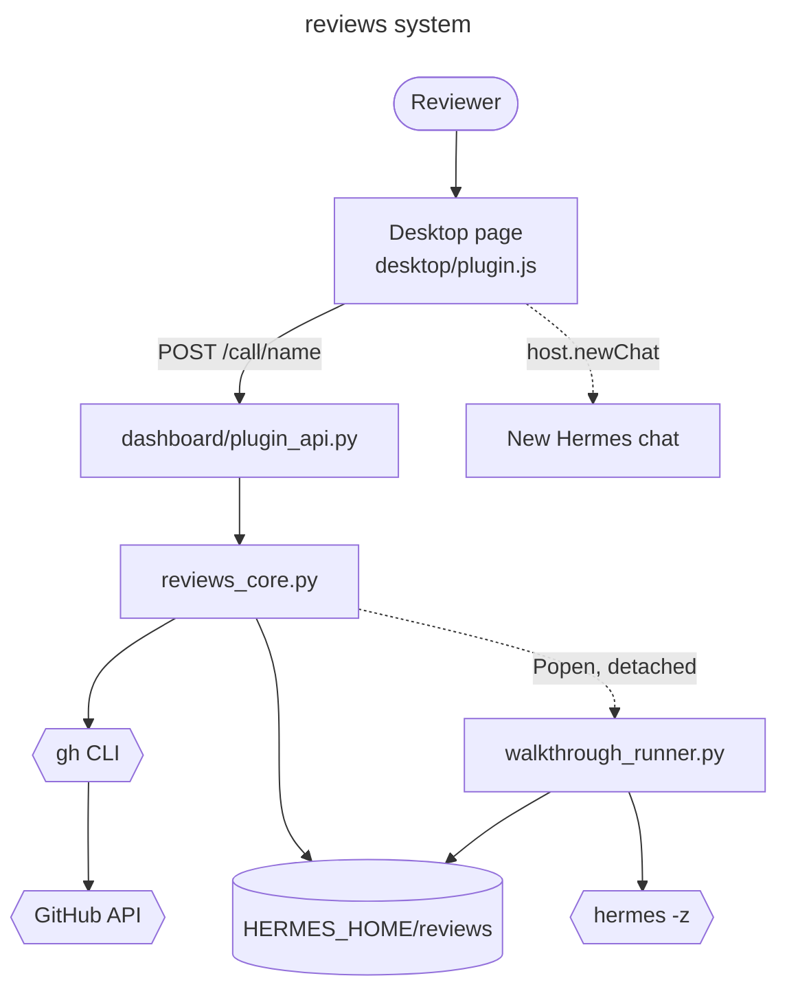

# About the architecture of Reviews

Reviews has three parts that run in three places. The Desktop page runs in Hermes Desktop. The backend runs inside the Hermes gateway as a plugin route. The walkthrough runner is a separate Python process that the backend starts and then leaves alone. GitHub is not called directly by any part. Every GitHub request is a `gh` subprocess with an argument list, so the plugin uses the account that is signed in to `gh`.

## System diagram

## Components

- **Desktop page**: React components in `desktop/src`, bundled into one ESM file. It registers a route `/reviews` and a sidebar row. See [modules/desktop-page.md](modules/desktop-page.md).
- **Gateway route**: one FastAPI route for every call. See [modules/dashboard-route.md](modules/dashboard-route.md).
- **Core**: one Python module with every backend function. See [modules/reviews-core.md](modules/reviews-core.md).
- **Walkthrough runner**: one process per walkthrough. See [modules/walkthrough-runner.md](modules/walkthrough-runner.md).
- **Local state**: `state.json` (the hidden list) and one folder per walkthrough, under `$HERMES_HOME/reviews/`. See [api.md](api.md#files-on-disk).

## Data flow

1. **The page asks for data**: `call(name, {id, body})` in [`desktop/src/api.js`](../../desktop/src/api.js) sends `POST /call/<name>?id=<id>` through `ctx.rest`.
2. **The route checks and dispatches**: `refusal()` and `call()` in [`dashboard/plugin_api.py`](../../dashboard/plugin_api.py) reload `reviews_core` and run `api_<name>(id, body)` in a thread pool.
3. **The core calls GitHub**: `gh()` in [`reviews_core.py`](../../reviews_core.py) runs the `gh` binary with a 30 second timeout and returns its stdout.
4. **The core shapes the answer**: `shape()`, `api_pr()` and the other `api_*` functions return plain JSON objects with `ok: true`.
5. **Walkthroughs leave the request**: `api_walkthrough()` writes `input.md` and `files.json`, starts the runner, and returns at once. The page then polls `walkthrough_status`.

## Design decisions

### One generic route instead of one route per call

The route maps `/call/<name>` to `reviews_core.api_<name>`. A new backend call is one new function in `reviews_core.py`. The route also reloads `reviews_core` on every request. Backend edits are therefore live without a gateway restart. The cost is that a change to `dashboard/plugin_api.py` itself still needs a restart, and every request pays for one module reload.

### The `gh` CLI instead of a GitHub token

The plugin reads no token and stores no token. It runs `gh` with an argument list and never with a shell. Before that, it checks every user value with a regular expression (`PR_URL`, `PR_ID`, `OWNER`, `SHA`). The trade-off is a dependency on a local `gh` install and one subprocess per GitHub request. `api_pr()` reduces the wait with a thread pool that runs its seven jobs in parallel.

### Requests from other sites are refused

The route runs inside the gateway, so a web page in a browser could try to call it. `refusal()` accepts a request only if it has a JSON content type or the header `X-Reviews: 1`. Both of these force a CORS preflight, and the route never answers a preflight. When the browser sends `Sec-Fetch-Site`, the value must be `same-origin`. Calls that change data (`add`, `hide`, `unhide`, `walkthrough`) must be POST. The page sends every call as a POST with a JSON body. The reason is that the REST door of Desktop sends no JSON content type on a GET without a body.

### Walkthroughs run outside the gateway

A walkthrough can take minutes, so it cannot run inside an HTTP request. The core starts `walkthrough_runner.py` with `start_new_session=True`, so a gateway reload or restart does not stop it. The runner and the core share state only through files in the walkthrough folder. `status.json` holds the state and the process id. If the state is `running` but the process is gone, `walkthrough_status()` reports `error`. Each walkthrough folder has the head commit SHA in its path, so a new commit makes the old walkthrough `stale` instead of wrong.

### The model points at hunks, not at code

The model gets every hunk with an id in `input.md` and must answer with hunk ids only ([`walkthrough_guide.md`](../../walkthrough_guide.md)). `clean_walkthrough()` keeps only known ids, uses each id once, and moves every other hunk to `support`. The page then shows the real diff for each stop. A model can therefore choose a bad order, but it cannot show code that is not in the pull request. The same hunk split exists twice, as `split_hunks()` in Python and `splitHunks()` in JavaScript, and the two must stay equal.

### One bundled file for Desktop

Desktop loads a plugin from one ESM file and allows imports only from `@hermes/plugin-sdk` and `react`. Plugins get no `react-dom`, so the React builds of `@pierre/diffs` and `@pierre/trees` are not usable. `desktop/src/diffs.js` wraps their plain DOM classes in small React components instead. `scripts/build.mjs` bundles everything and cuts Shiki down to a list of 31 languages and the Flexoki theme. The built file is about 2.9 MB and is committed, so a fresh clone has a usable page without a build.

## Related pages

- Every call and its fields: [api.md](api.md)
- The main workflows step by step: [diagrams/sequences.md](diagrams/sequences.md)
