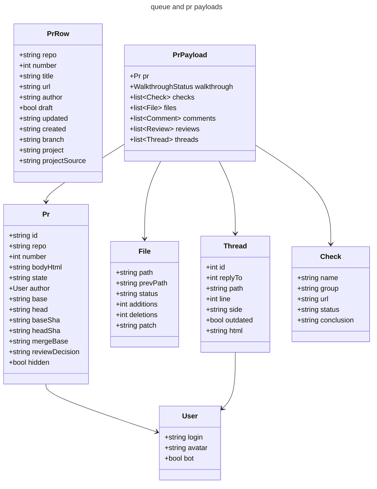
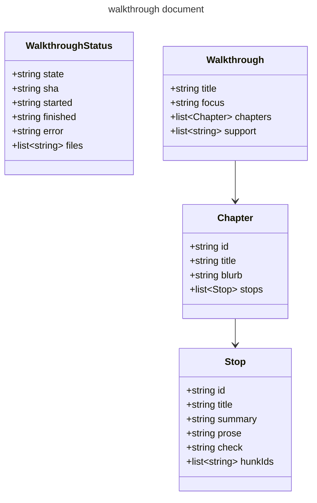

# Data types

The backend and the Desktop page share plain JSON objects. The code has no classes for them. The diagrams below show the fields that `reviews_core.py` writes. Sources: `shape()`, `api_list()`, `api_pr()`, `_check()`, `_user()`, `walkthrough_status()` and `clean_walkthrough()` in [`reviews_core.py`](../../../reviews_core.py).

## Queue and PR page

`Pr` also has `url`, `title`, `draft`, `headRepo`, `additions`, `deletions`, `changedFiles`, `commits`, `created`, `updated` and `labels` (`{name, color}`). `Comment` has `id`, `user`, `html`, `created` and `url`. `Review` has the same fields plus `state`. `Thread` also has `user`, `created` and `url`.

## Walkthrough

## Notes

- `state` in `WalkthroughStatus` is `none`, `running`, `done`, `error` or `stale`. For `stale`, only `state` and `sha` are present. For `none`, only `state` is present.
- `hunkIds` and `support` hold hunk ids in the form `<path>:h<n>`.
- `Thread.outdated` is true when GitHub gives no `line`. `Thread.side` is `RIGHT` when GitHub gives no side.
- `Check` normalises two GitHub types. A `StatusContext` maps `SUCCESS`, `FAILURE` and `ERROR` to a conclusion, and `PENDING` or `EXPECTED` to `IN_PROGRESS`.
- `File.patch` is `null` when GitHub gives no text diff.
