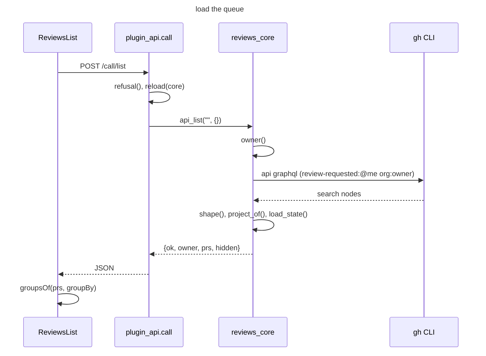
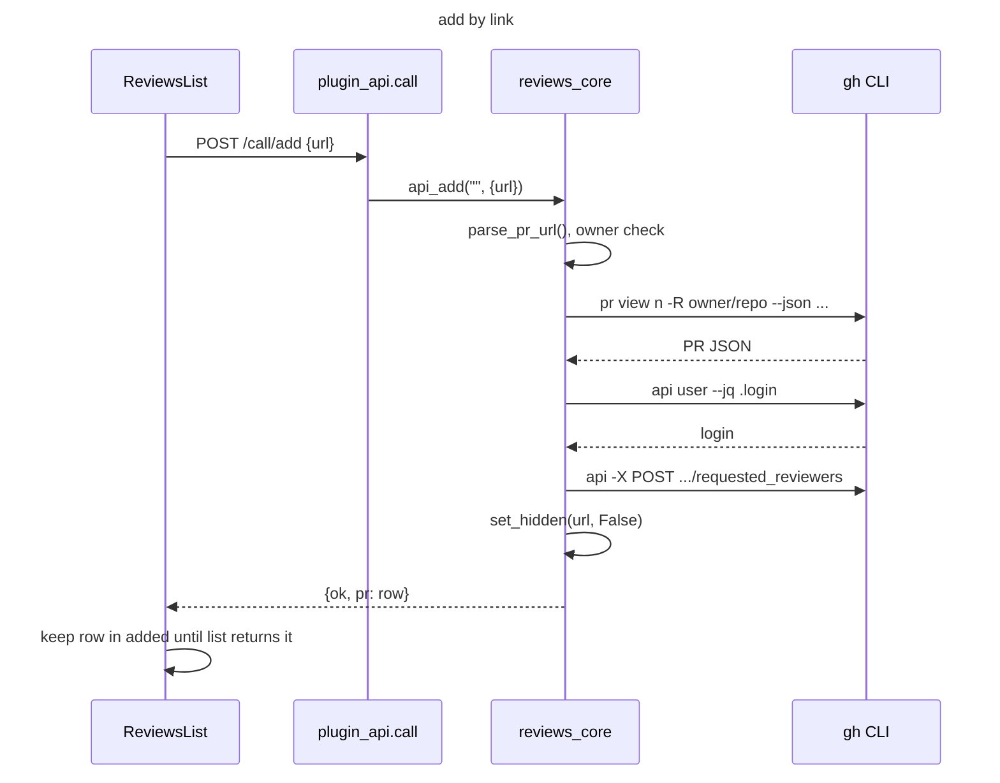
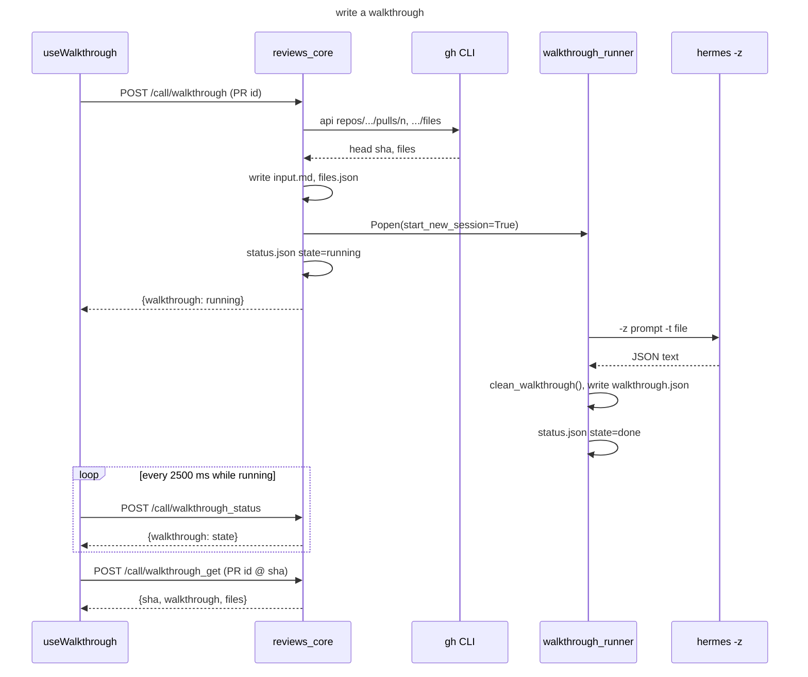

# Sequence diagrams

Each diagram traces one workflow through the real files. Participants are the Desktop page, `dashboard/plugin_api.py` (Route), `reviews_core.py` (Core), the `gh` CLI, `walkthrough_runner.py` (Runner) and the `hermes` CLI.

## Workflow: load the queue

The queue view calls `list` when it opens and every 2 minutes.

### Steps in the code

1. **Request**: `load()` in [`desktop/src/list.jsx`](../../../desktop/src/list.jsx) calls `call('list')` in [`desktop/src/api.js`](../../../desktop/src/api.js).
2. **Checks**: `refusal()` and `call()` in [`dashboard/plugin_api.py`](../../../dashboard/plugin_api.py).
3. **Search**: `api_list()` runs `gh api graphql` with `SEARCH_QUERY` in [`reviews_core.py`](../../../reviews_core.py).
4. **Rows**: `shape()` and `project_of()` build each row. URLs in `state.json` go to `hidden`.
5. **View**: `groupsOf()` in `list.jsx` groups the rows.

## Workflow: add a pull request by link

The user pastes a PR link in the queue view and presses Add.

### Steps in the code

1. **Request**: `add()` in [`desktop/src/list.jsx`](../../../desktop/src/list.jsx).
2. **Checks**: `api_add()` in [`reviews_core.py`](../../../reviews_core.py) refuses another owner, a state other than `OPEN`, and your own pull request.
3. **Review request**: `gh api -X POST repos/<owner>/<repo>/pulls/<n>/requested_reviewers -f reviewers[]=<login>`.
4. **Hidden list**: `set_hidden(url, False)` shows the pull request again if it was hidden.
5. **View**: the row goes to the top of the queue and stays in `added.current` until GitHub search returns it.

## Workflow: write a walkthrough

The user presses "Walk me through" on the PR page. The model runs in a detached process, and the page polls.

All page calls go through `dashboard/plugin_api.py`. The diagram leaves the route out to save space.

### Steps in the code

1. **Start**: `start()` in [`desktop/src/walkthrough.jsx`](../../../desktop/src/walkthrough.jsx) calls `walkthrough`.
2. **Input**: `api_walkthrough()` in [`reviews_core.py`](../../../reviews_core.py) writes `input.md` with `write_input()` and `files.json`.
3. **Process**: `subprocess.Popen` starts [`walkthrough_runner.py`](../../../walkthrough_runner.py) with `run.log` as stdout and stderr.
4. **Model**: `main()` runs `hermes -z` with the prompt from `prompt()` and [`walkthrough_guide.md`](../../../walkthrough_guide.md).
5. **Clean**: `extract_json()` and `core.clean_walkthrough()` keep only known hunk ids.
6. **Poll**: `useWalkthrough` calls `walkthrough_status` every 2500 ms. `walkthrough_status()` reads `status.json` and checks the process id.
7. **Show**: on `done`, the hook calls `walkthrough_get`, and `Stop` shows the hunks of each stop.
