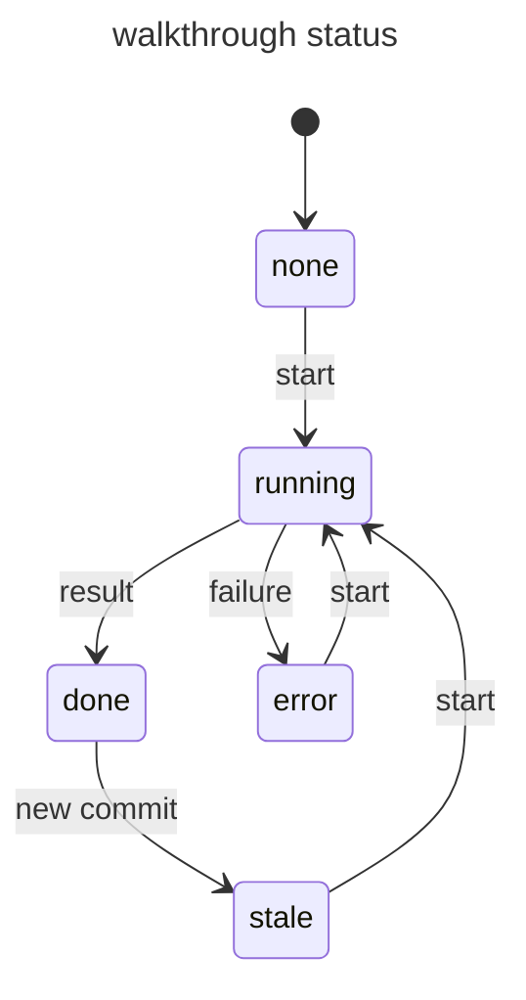

# Module: `walkthrough_runner.py`

`walkthrough_runner.py` writes one walkthrough in a separate process. `reviews_core.api_walkthrough()` starts it with `python walkthrough_runner.py <folder>`. Source: [`walkthrough_runner.py`](../../../walkthrough_runner.py). The prompt rules for the model are in [`walkthrough_guide.md`](../../../walkthrough_guide.md).

## Responsibilities

- Run `hermes -z` in the walkthrough folder with the authoring guide as the prompt.
- Keep auto-approve settings of the parent away from the child agent.
- Check the model answer against the real hunk ids.
- Write `walkthrough.json` and the final `status.json`.

## Public API

| Name | Signature | Description |
|---|---|---|
| `main` | `(folder: Path) -> int` | One full run. Returns 0 on success, 1 on failure. |
| `hermes_bin` | `() -> str` | `shutil.which("hermes")`, then `~/.hermes/hermes-agent/.hermes/bin/hermes`, then `~/.local/bin/hermes`. Raises `RuntimeError`. |
| `prompt` | `(guide: str) -> str` | Fixed instruction text plus the full guide. |
| `extract_json` | `(text: str) -> dict` | Parses the text from the first `{` to the last `}`. Raises `ValueError`. |
| `set_status` | `(folder: Path, **fields) -> None` | Merges fields into `status.json` through a `.tmp` file and rename. |
| `TIMEOUT` | `int` | `15 * 60` seconds. |
| `DROP_ENV` | `tuple[str, ...]` | Env var prefixes removed for the child: `HERMES_YOLO`, `HERMES_YOLO_MODE`, `HERMES_ACP_AUTO_APPROVE`. |

## Run steps

`main()` does these steps:

1. Writes its own `pid` to `status.json`.
2. Reads `files.json` and builds the hunk ids with `core.hunk_ids()`.
3. Runs `hermes -z <prompt> -t file --usage-file usage.json`, plus `-m` and `--provider` when the settings have values. The working folder is the walkthrough folder.
4. Writes stdout to `raw.txt`.
5. Parses the JSON and cleans it with `core.clean_walkthrough()`.
6. Writes `walkthrough.json` through `walkthrough.tmp` and rename, then sets `state: "done"` and `finished`.

A timeout sets `state: "error"` with `the walkthrough took longer than 15 minutes`. Any other exception sets `state: "error"` with the first 400 characters of the message.

## Status states

In the diagram, `start` is a call to `api_walkthrough()`. `result` is a written `walkthrough.json`. `failure` is an exception, a timeout, or a process id that is not alive. `new commit` is a new head SHA on the pull request.

`stale` and `none` are not written to `status.json`. `walkthrough_status()` computes them from the folders on disk.

## Dependencies

- **Used by:** `reviews_core.api_walkthrough()` (as a subprocess).
- **Uses:** [`reviews_core`](reviews-core.md) (`hunk_ids`, `clean_walkthrough`, `walkthrough_settings`, `ROOT`, `_now`), the `hermes` CLI. The core puts the repository root on `PYTHONPATH` for the import.

## Notes

- The process runs with `start_new_session=True`. A gateway restart does not stop it.
- `-t file` gives the child agent the file toolset. The child reads `./input.md` with it.
